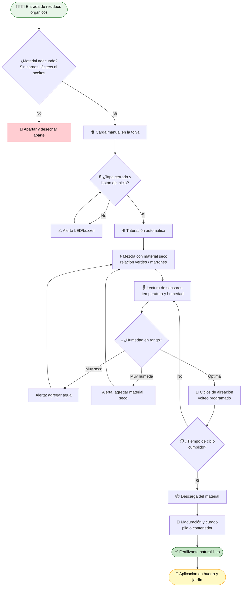
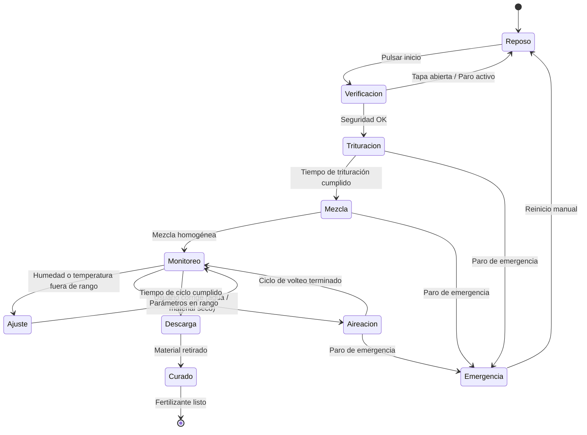
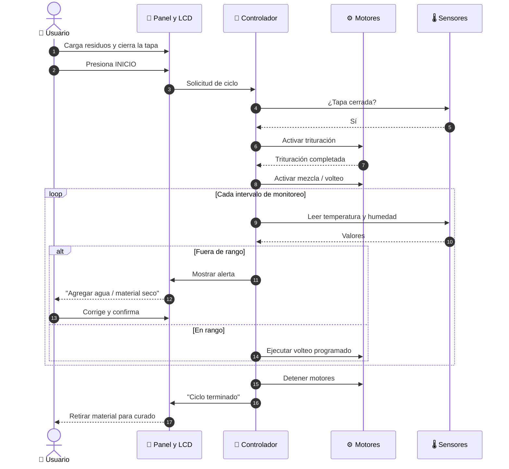
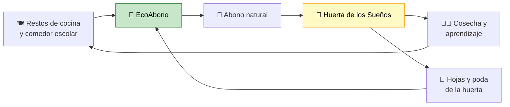

<div align="center">

# 🌱♻️ EcoAbono — Máquina Semiautomática de Bajo Costo para Transformar Residuos Orgánicos en Fertilizante Natural 🌿

**Del plato a la huerta: convierte tus residuos de cocina y jardín en abono, sin vertederos y sin gastar de más.**

[](#-métricas-y-resultados)
[](./LICENSE)
[](#️-guía-de-réplica--hágalo-usted-mismo)
[](#-simulación-y-modelado)
[](#-impacto-ambiental-y-económico)
[](#-contribuir)
[](https://github.com/TU-USUARIO/ecoabono/actions/workflows/ci.yml)
[](https://TU-USUARIO.github.io/ecoabono/)

*Proyecto académico · Escala doméstica · Open Source*

🌐 **[Ver sitio web](https://TU-USUARIO.github.io/ecoabono/)** · 📘 [Cómo publicar este repositorio](./docs/PUBLICAR.md)

</div>

---

## 📑 Tabla de Contenidos

1. [📖 Resumen del Proyecto](#-resumen-del-proyecto)
2. [🚨 Planteamiento del Problema](#-planteamiento-del-problema)
3. [🎯 Objetivos y Alcance](#-objetivos-y-alcance)
4. [🏗️ Arquitectura y Funcionamiento Semiautomático](#️-arquitectura-y-funcionamiento-semiautomático)
5. [🔄 Ciclo del Proceso (Diagramas de Estado y Secuencia)](#-ciclo-del-proceso)
6. [⚖️ Comparativa: Máquina vs. Compostaje Tradicional vs. Abono Comercial](#️-comparativa)
7. [📊 Métricas y Resultados](#-métricas-y-resultados)
8. [🌍 Impacto Ambiental y Económico](#-impacto-ambiental-y-económico)
9. [🛠️ Guía de Réplica / Hágalo Usted Mismo](#️-guía-de-réplica--hágalo-usted-mismo)
10. [🧪 Simulación y Modelado](#-simulación-y-modelado)
11. [🌻 Caso de Estudio: Huerta de los Sueños](#-caso-de-estudio-huerta-de-los-sueños)
12. [🦺 Seguridad](#-seguridad)
13. [📂 Estructura del Repositorio](#-estructura-del-repositorio)
14. [🤝 Contribuir](#-contribuir)
15. [👥 Equipo y Agradecimientos](#-equipo-y-agradecimientos)
16. [📜 Licencia](#-licencia)

---

## 📖 Resumen del Proyecto

**EcoAbono** es el diseño y construcción de una **máquina semiautomática de bajo costo** que recibe residuos orgánicos domésticos (cáscaras de frutas, restos de verduras, hojas) y los **tritura, mezcla, airea y monitorea** para acelerar su transformación en **fertilizante natural**.

Está pensada para tres tipos de usuarios:

| 👤 Usuario | 🎯 Necesidad |
|---|---|
| 🏡 Hogares con jardín o plantas | Una forma limpia y sencilla de reciclar sus residuos de cocina |
| 👨‍👩‍👧 Familias con huertas caseras | Abono propio, económico y de calidad conocida |
| 🏫 **Huerta de los Sueños** (nuestra institución educativa) | Producir fertilizante para la huerta escolar y usarlo como herramienta pedagógica |

> [!NOTE]
> **¿Qué hace diferente a EcoAbono?** No intenta ser una máquina industrial. Es un prototipo **abierto, reproducible y económico**, que combina componentes accesibles (motor, tambor, sensores y un microcontrolador) con una operación **semiautomática**: la persona carga y supervisa; la máquina tritura, mezcla, airea y controla.

---

## 🚨 Planteamiento del Problema

Una parte muy grande de la basura de un hogar es **orgánica**. Cuando termina mezclada en un vertedero, se descompone sin oxígeno y genera problemas serios:

- 🤢 **Malos olores** que afectan a las comunidades cercanas.
- 💧 **Lixiviados**: líquidos contaminantes que pueden filtrarse al suelo y al agua.
- 🌫️ **Gases de efecto invernadero (GEI)**, especialmente **metano (CH₄)**, producido por la descomposición anaerobia.
- 🗑️ **Pérdida de un recurso valioso**: esos residuos contienen nutrientes que podrían volver al suelo.

> [!WARNING]
> **El problema no es solo la basura, es el desperdicio de nutrientes.** Lo que hoy se entierra en un vertedero podría ser el abono que hoy compramos empaquetado.

> [!TIP]
> **Nuestra respuesta:** descentralizar el tratamiento. Si cada hogar o comunidad procesa sus residuos orgánicos en el lugar donde se generan, se reduce el volumen que viaja al vertedero y se genera fertilizante en el mismo sitio donde se necesita.

---

## 🎯 Objetivos y Alcance

**🎯 Objetivo general:** diseñar, construir y evaluar una máquina semiautomática de bajo costo que transforme residuos orgánicos domésticos en fertilizante natural.

**📌 Objetivos específicos**

1. Diseñar un prototipo mecánico-electrónico con materiales accesibles.
2. Medir su **eficiencia y rendimiento** (capacidad, kg/h, tiempo de ciclo, residuo no procesado).
3. Caracterizar la **calidad física** del fertilizante obtenido (color, textura, olor, humedad).
4. Estimar el **impacto ambiental y el balance económico** frente a alternativas comerciales.
5. Documentar todo el proceso para que **cualquiera pueda replicarlo**.

| ✅ Dentro del alcance | ❌ Fuera del alcance |
|---|---|
| Escala doméstica / comunitaria pequeña | Procesamiento industrial o municipal |
| Prototipo funcional + simulación | Producción comercial certificada |
| Residuos de frutas, verduras y hojas | Carnes, lácteos, aceites, excrementos de mascotas |
| Caracterización física del abono | Análisis de laboratorio completo (NPK, metales pesados)* |

<sub>*Se recomienda complementar con análisis de laboratorio como trabajo futuro.</sub>

---

## 🏗️ Arquitectura y Funcionamiento Semiautomático

### Componentes principales

| # | Módulo | Función |
|---|---|---|
| 1 | 🪣 **Tolva de carga** | Recibe los residuos. Incluye tapa con sensor de seguridad. |
| 2 | ⚙️ **Unidad de trituración** | Reduce el tamaño de partícula para acelerar la descomposición. |
| 3 | 🌀 **Tambor de mezcla y aireación** | Mezcla residuos húmedos ("verdes") con material seco ("marrones", como hojas secas) y aporta oxígeno. |
| 4 | 🌡️ **Módulo de sensores** | Mide temperatura y humedad de la mezcla. |
| 5 | 🧠 **Controlador (Arduino)** | Coordina motores, tiempos, alertas y seguridad. |
| 6 | 🔘 **Panel de usuario** | Botón de inicio, parada de emergencia, pantalla LCD y LEDs de estado. |
| 7 | 📦 **Salida / recolección** | Compuerta y bandeja para retirar el material procesado. |

### 🔀 Diagrama de flujo del proceso



### 🤝 ¿Qué significa "semiautomático"?

| 🧑 Lo hace la persona | 🤖 Lo hace la máquina |
|---|---|
| Seleccionar y cargar los residuos | Triturar |
| Agregar material seco o agua según las alertas | Mezclar y airear por ciclos |
| Iniciar el ciclo | Medir temperatura y humedad |
| Retirar y curar el abono | Detener el proceso ante una condición insegura |

> [!IMPORTANT]
> **Sobre el tiempo real del compostaje:** la máquina **acelera y optimiza** las etapas de preparación, mezcla y aireación, pero la **maduración biológica completa** del abono requiere tiempo (días a semanas) en la etapa de curado. Documentamos honestamente ambas fases en nuestras métricas.

<details>
<summary><b>🔧 Detalle técnico: componentes electrónicos y lógica de control (clic para desplegar)</b></summary>

<br/>

**Electrónica sugerida**

| Componente | Uso |
|---|---|
| Arduino UNO / Nano | Control central |
| Sensor de humedad capacitivo | Humedad de la mezcla |
| Sensor de temperatura (DS18B20 o termistor) | Temperatura interna |
| Módulo relé (2 canales) | Activar motor de trituración y motor de volteo |
| Interruptor de tapa (final de carrera) | Interlock de seguridad |
| Pulsador de inicio + seta de paro de emergencia | Operación y seguridad |
| LCD 16x2 I2C | Estado, temperatura, humedad, tiempo restante |
| LEDs + buzzer | Alertas |
| Fuente de alimentación adecuada al motor | Alimentación |

**Código real del firmware:** [`firmware/ecoabono/ecoabono.ino`](./firmware/ecoabono/ecoabono.ino) · pruebas en [`firmware/pruebas/`](./firmware/pruebas) · librerías y pines en [`LIBRERIAS.md`](./firmware/LIBRERIAS.md)

**Pseudocódigo de la lógica de control**

```text
INICIO
  esperar(botón_inicio)
  SI tapa_abierta O paro_emergencia ENTONCES
      detener_motores(); alerta("Cerrar tapa"); volver a INICIO
  FIN SI

  activar(trituración, T_trituración)
  activar(volteo, T_mezcla)

  REPETIR hasta (tiempo_ciclo_cumplido):
      leer(temperatura, humedad)
      SI humedad < HUM_MIN ENTONCES alerta("Agregar agua")
      SI humedad > HUM_MAX ENTONCES alerta("Agregar material seco")
      SI temperatura > TEMP_MAX ENTONCES alerta("Aumentar aireación")
      volteo_periódico(intervalo, duración)
      SI tapa_abierta ENTONCES detener_motores()
  FIN REPETIR

  finalizar_ciclo(); indicar("Listo para descarga")
FIN
```

**Parámetros de referencia (ajustar con pruebas propias)**

| Parámetro | Rango de referencia |
|---|---|
| Humedad de la mezcla | ~50 % – 60 % |
| Temperatura en fase activa | ~45 °C – 65 °C |
| Relación C:N (marrones : verdes) | ~25–30 : 1 |
| Tamaño de partícula | Lo más pequeño posible sin compactar |

> Estos valores son referencias generales de la literatura sobre compostaje. **Valídalos y registra los tuyos** en `data/`.

</details>

---

## 🔄 Ciclo del Proceso

### 🔁 Diagrama de estados de la máquina



### 📨 Diagrama de secuencia (interacción usuario ↔ máquina)



<details>
<summary><b>🧪 Fases biológicas detrás del proceso (clic para desplegar)</b></summary>

<br/>

| Fase | Qué ocurre | Cómo ayuda la máquina |
|---|---|---|
| **1. Mesófila** | Microorganismos comienzan a descomponer la materia fácil | Trituración: más superficie de contacto |
| **2. Termófila** | La temperatura sube; se degradan compuestos complejos y se reduce la carga de patógenos | Mezcla y aireación mantienen oxígeno y evitan sobrecalentamiento |
| **3. Enfriamiento** | La actividad baja, la temperatura desciende | Monitoreo de temperatura |
| **4. Maduración / curado** | El material se estabiliza y adquiere aspecto de tierra | Descarga y curado en reposo |

</details>

---

## ⚖️ Comparativa

> Tabla de referencia cualitativa. Completa las celdas marcadas con **📏** con tus mediciones reales en la sección de [Métricas](#-métricas-y-resultados).

| Criterio | 🤖 **EcoAbono (máquina)** | 🍂 **Compostaje tradicional** | 🛍️ **Abono comercial** |
|---|---|---|---|
| **Costo inicial** | Medio-bajo (construcción única) | Muy bajo | Nulo |
| **Costo recurrente** | Muy bajo (energía) | Casi nulo | Alto (compra continua) |
| **Esfuerzo manual** | Medio (carga y supervisión) | Alto (volteo frecuente) | Ninguno |
| **Tiempo de proceso** | 📏 Reducido en fase activa | Largo (semanas a meses) | Inmediato |
| **Control de variables** | Alto (sensores y alertas) | Bajo (por experiencia) | Fijo (formulado por fabricante) |
| **Olores y plagas** | Menores (proceso cerrado y aireado) | Variables según manejo | Ninguno |
| **Espacio requerido** | Compacto | Mayor | Mínimo |
| **Reduce residuos al vertedero** | ✅ Sí | ✅ Sí | ❌ No |
| **Valor educativo** | ⭐⭐⭐⭐⭐ | ⭐⭐⭐ | ⭐ |
| **Reproducible por la comunidad** | ✅ Documentación abierta | ✅ | ❌ |
| **Huella ambiental** | Baja | Muy baja | Media-alta (producción y transporte) |

<details>
<summary><b>🔍 ¿Cuándo conviene cada opción? (clic para desplegar)</b></summary>

<br/>

- **Máquina EcoAbono:** hogares o instituciones con generación constante de residuos que quieren reducir esfuerzo manual y aprender del proceso.
- **Compostaje tradicional:** quienes tienen espacio, tiempo y no requieren velocidad.
- **Abono comercial:** cuando se necesita una formulación nutricional específica y exacta, o no hay capacidad de producción propia.

> [!NOTE]
> No son excluyentes: el abono propio puede **complementar** o reducir la compra de productos comerciales.

</details>

---

## 📊 Métricas y Resultados

> [!IMPORTANT]
> **Cómo usar esta sección:** las tablas incluyen las variables que se miden en el proyecto. Reemplaza los campos `___` con los **datos reales** de tus pruebas y guarda las mediciones crudas en [`/data`](./data). Mantener la trazabilidad de los datos es lo que hace creíble un proyecto.

### ⚙️ 1. Eficiencia y Rendimiento

| Variable | Definición | Fórmula | Resultado |
|---|---|---|---|
| **Capacidad técnica** | Máxima masa de residuos por carga | Medición directa | `___ kg/carga` |
| **Tiempo de ciclo** | Duración de un ciclo completo | t_fin − t_inicio | `___ min` |
| **Rendimiento** | Masa procesada por hora | `m_procesada / t_ciclo` | `___ kg/h` |
| **% de aprovechamiento** | Porcentaje de residuo efectivamente transformado | `((m_entrada − m_no_procesada) / m_entrada) × 100` | `___ %` |
| **Residuo no procesado** | Material que no se trituró o transformó | Pesaje | `___ kg (___ %)` |
| **Consumo energético** | Energía por ciclo | `P × t` | `___ Wh/ciclo` |

**📋 Plantilla de registro de pruebas** (`data/pruebas_rendimiento.csv`)

📥 **Descarga la plantilla:** [`data/pruebas_rendimiento.csv`](./data/pruebas_rendimiento.csv)

<details>
<summary><b>🧮 Script para calcular métricas automáticamente (clic para desplegar)</b></summary>

<br/>

📥 **Script:** [`scripts/calcular_metricas.py`](./scripts/calcular_metricas.py)

```bash
pip install -r requirements.txt
python scripts/calcular_metricas.py
```

</details>

### 🌱 2. Calidad del Fertilizante (caracterización física)

| Parámetro | Cómo se evalúa | Valor esperado en abono maduro | Resultado obtenido |
|---|---|---|---|
| 🎨 **Color** | Observación visual (comparar con escala/foto de referencia) | Marrón oscuro a negro | `___` |
| ✋ **Textura** | Tacto: desmenuzable, granular, sin trozos reconocibles | Homogénea, tipo tierra suelta | `___` |
| 👃 **Olor** | Olfativo | A tierra húmeda de bosque; sin olor a podrido ni amoníaco | `___` |
| 💧 **Humedad** | *Prueba del puño* y/o método de secado y pesaje | ~30 % – 50 % (referencia) | `___ %` |
| 🌡️ **Temperatura final** | Termómetro | Cercana a la ambiente | `___ °C` |
| 🔬 **Partículas reconocibles** | Inspección | Mínimas | `___` |

<details>
<summary><b>🧪 Protocolos caseros de verificación (clic para desplegar)</b></summary>

<br/>

**✊ Prueba del puño (humedad):** toma un puñado y apriétalo.
- Gotea agua → **demasiado húmedo**.
- Forma un bloque que se desmorona suavemente → **humedad adecuada**.
- Se deshace sin formar bloque → **demasiado seco**.

**💧 Humedad por pesaje (si hay balanza y horno/estufa disponible):**

```text
Humedad (%) = ((masa_húmeda − masa_seca) / masa_húmeda) × 100
```

**🌿 Prueba de germinación (indicador práctico de madurez):**
1. Mezcla abono y tierra en proporción conocida.
2. Siembra semillas de rápido crecimiento (rábano, lechuga, fríjol).
3. Compara germinación y crecimiento con un grupo de control sin abono.
4. Registra % de germinación y altura a los 7–14 días.

</details>

---

## 🌍 Impacto Ambiental y Económico

### ♻️ Impacto ambiental

| Indicador | Cálculo | Resultado |
|---|---|---|
| Residuos orgánicos desviados del vertedero | Σ masa procesada | `___ kg` |
| Reducción de masa (entrada → abono) | `((m_entrada − m_abono) / m_entrada) × 100` | `___ %` |
| Reducción de volumen | `((V_entrada − V_abono) / V_entrada) × 100` | `___ %` |
| Proyección anual por hogar | `kg/semana × 52` | `___ kg/año` |
| Proyección anual institucional | Datos de la institución | `___ kg/año` |
| Emisiones evitadas (estimadas) | `kg desviados × factor de emisión*` | `___ kg CO₂e` |

<sub>*Usa un factor de emisión de una fuente oficial o científica citada y registra la referencia en `docs/referencias.md`. No uses un valor sin citar su origen.</sub>

> [!TIP]
> **Proyección de impacto:** si `n` hogares adoptaran el sistema, el desvío anual estimado sería `n × kg/año por hogar`. Esto convierte un prototipo escolar en un modelo escalable.

### 💰 Balance económico

**Inversión inicial (lista de materiales)**

| # | Componente | Cantidad | Costo unitario | Subtotal |
|---|---|---|---|---|
| 1 | Motor / motorreductor | 1 | `$ ___` | `$ ___` |
| 2 | Estructura (perfiles, lámina, tambor reutilizado) | 1 | `$ ___` | `$ ___` |
| 3 | Sistema de trituración (cuchillas, eje) | 1 | `$ ___` | `$ ___` |
| 4 | Arduino + módulo relé | 1 | `$ ___` | `$ ___` |
| 5 | Sensores (humedad, temperatura) | 2 | `$ ___` | `$ ___` |
| 6 | LCD, LEDs, buzzer, pulsadores, paro de emergencia | 1 kit | `$ ___` | `$ ___` |
| 7 | Cableado, fuente, protecciones | 1 | `$ ___` | `$ ___` |
| 8 | Tornillería y acabados | 1 | `$ ___` | `$ ___` |
| | **💵 TOTAL** | | | **`$ ___`** |

**Comparación con fertilizante comercial**

| Concepto | Valor |
|---|---|
| Costo del fertilizante comercial equivalente (por kg) | `$ ___` |
| Abono producido por mes | `___ kg` |
| Ahorro mensual bruto | `kg producidos × costo comercial` → `$ ___` |
| Costo operativo mensual (energía, mantenimiento) | `$ ___` |
| **Ahorro mensual neto** | `$ ___` |
| **Punto de equilibrio** | `Inversión / Ahorro neto mensual` → `___ meses` |

<details>
<summary><b>📈 Calculadora de punto de equilibrio (clic para desplegar)</b></summary>

<br/>

📥 **Script:** [`scripts/punto_equilibrio.py`](./scripts/punto_equilibrio.py)

```bash
python scripts/punto_equilibrio.py --inversion 0 --kg-mes 0 --precio-kg 0 --costo-mes 0
```

> [!NOTE]
> Para una comparación justa, ten en cuenta que un abono orgánico casero y un fertilizante químico no tienen igual composición nutricional. Compáralos contra un **abono orgánico comercial**, o menciona esta limitación en tus conclusiones.

</details>

---

## 🛠️ Guía de Réplica / Hágalo Usted Mismo

> [!CAUTION]
> Este proyecto incluye **partes móviles, cuchillas y electricidad**. Si eres menor de edad, construye **siempre con supervisión de un adulto o docente**. Lee la sección de [Seguridad](#-seguridad) antes de empezar.

**⏱️ Tiempo estimado:** `___ horas` · **🧰 Dificultad:** Intermedia · **💵 Costo:** ver [balance económico](#-balance-económico)

### 🧾 Fase 0 — Preparación

- [ ] Leer completa esta guía y la sección de seguridad.
- [ ] Conseguir un espacio de trabajo ventilado y bien iluminado.
- [ ] Reunir herramientas: taladro, sierra, destornilladores, multímetro, soldador, equipo de protección.
- [ ] Comprar o reunir todos los materiales de la lista (BOM).
- [ ] Clonar el repositorio:

```bash
git clone https://github.com/TU-USUARIO/ecoabono.git
cd ecoabono
```

### 🏗️ Fase 1 — Estructura mecánica

- [ ] Cortar y armar el bastidor según los planos en `/hardware/planos`.
- [ ] Preparar el tambor / contenedor de mezcla (material apto y sin bordes filosos).
- [ ] Instalar el eje y los soportes con rodamientos.
- [ ] Montar la tolva de carga con su tapa.
- [ ] Instalar la unidad de trituración (cuchillas con protección).
- [ ] Verificar giro libre **a mano** antes de conectar cualquier motor.

### ⚡ Fase 2 — Electrónica

- [ ] Armar el circuito según el esquema en `/hardware/esquema_electrico`.
- [ ] Conectar el módulo relé con **aislamiento adecuado** entre control y potencia.
- [ ] Instalar el interruptor de tapa (interlock) y la **parada de emergencia**.
- [ ] Conectar sensores de humedad y temperatura.
- [ ] Conectar LCD, LEDs y buzzer.
- [ ] Probar cada componente por separado con los sketches de `/firmware/pruebas`.

### 💻 Fase 3 — Firmware

- [ ] Instalar el [Arduino IDE](https://www.arduino.cc/en/software).
- [ ] Instalar las librerías indicadas en `firmware/LIBRERIAS.md`.
- [ ] Calibrar el sensor de humedad (valor en aire y en agua).
- [ ] Cargar `firmware/ecoabono/ecoabono.ino`.
- [ ] Verificar por monitor serie que las lecturas son coherentes.
- [ ] Probar que **abrir la tapa detiene los motores**.

### 🧪 Fase 4 — Pruebas en vacío y con carga

- [ ] Ejecutar un ciclo **en vacío**, observando vibraciones, ruidos y temperatura de los motores.
- [ ] Ejecutar un ciclo con una carga **pequeña** (≈ 20 % de la capacidad).
- [ ] Registrar datos en `data/pruebas_rendimiento.csv`.
- [ ] Ajustar tiempos de trituración, mezcla y volteo.
- [ ] Repetir con al menos **3 pruebas** por tipo de residuo.

### 🌱 Fase 5 — Producción y curado

- [ ] Preparar la mezcla: residuos húmedos + material seco (hojas secas, cartón sin tinta).
- [ ] Ejecutar el ciclo completo.
- [ ] Descargar el material y llevarlo a un contenedor de curado con ventilación.
- [ ] Controlar humedad y temperatura durante la maduración.
- [ ] Evaluar color, textura, olor y humedad (ver [calidad](#-2-calidad-del-fertilizante-caracterización-física)).
- [ ] Hacer una prueba de germinación antes de aplicarlo a gran escala.

### 📣 Fase 6 — Comparte tu réplica

- [ ] Documentar tus resultados y modificaciones.
- [ ] Abrir un *Issue* o *Pull Request* con tus mejoras.
- [ ] ⭐ Dar una estrella al repositorio si te fue útil.

<details>
<summary><b>🧯 Solución de problemas frecuentes (clic para desplegar)</b></summary>

<br/>

| Síntoma | Causa probable | Solución |
|---|---|---|
| Mal olor persistente | Exceso de humedad o poca aireación | Agregar material seco; aumentar frecuencia de volteo |
| La mezcla se compacta | Partículas muy finas o muy húmedas | Añadir material estructurante (hojas secas, ramitas) |
| Motor se recalienta | Sobrecarga o atascos | Reducir la carga; revisar cuchillas y ejes |
| Temperatura no sube | Poca masa o mezcla muy seca | Aumentar carga; ajustar humedad |
| Lecturas de humedad erráticas | Sensor sin calibrar o con mal contacto | Recalibrar; limpiar y reubicar sensor |
| Moscas | Residuos expuestos | Cubrir con material seco; cerrar tapa |

</details>

---

## 🧪 Simulación y Modelado

El proyecto incluye una **simulación** que complementa el prototipo físico:

| Tipo | Herramienta sugerida | Archivo |
|---|---|---|
| 🔌 Circuito y lógica de control | Tinkercad Circuits / Wokwi | `simulacion/circuito/` |
| 📐 Modelo 3D de la máquina | FreeCAD / Fusion 360 / SketchUp | `simulacion/cad/` |
| 📈 Modelo de proceso (balance de masa) | Python / Excel | `simulacion/modelo_proceso/` |

<details>
<summary><b>📉 Ejemplo: simulación simple de reducción de masa y humedad (clic para desplegar)</b></summary>

<br/>

📥 **Script:** [`simulacion/modelo_proceso/simulacion_basica.py`](./simulacion/modelo_proceso/simulacion_basica.py)

```bash
python simulacion/modelo_proceso/simulacion_basica.py --masa 5 --tasa 0.04 --dias 30
```

> [!NOTE]
> La tasa de pérdida (`perdida_diaria`) es un **supuesto del modelo**. Contrástala con tus pesajes reales y reporta la diferencia entre simulación y prototipo.

</details>

---

## 🌻 Caso de Estudio: Huerta de los Sueños

<div align="center">

### 🏫 Implementación en nuestra institución educativa

</div>

> [!NOTE]
> **Contexto:** la *Huerta de los Sueños* es un espacio educativo de la institución donde la comunidad cultiva y aprende sobre sostenibilidad. EcoAbono se integra como la pieza que cierra el ciclo: **los residuos del comedor y la huerta se convierten en el abono de la huerta**.

### 🔁 Ciclo cerrado propuesto



### 📋 Plan de implementación

- [ ] **Diagnóstico:** pesar durante 1–2 semanas los residuos orgánicos generados (comedor + huerta).
- [ ] **Capacitación:** taller para estudiantes sobre qué residuos sí y no se pueden ingresar.
- [ ] **Instalación:** ubicar la máquina en un sitio cubierto, ventilado y con acceso eléctrico seguro.
- [ ] **Protocolo de uso:** definir turnos, responsables y registro de cada ciclo.
- [ ] **Producción:** ejecutar ciclos y curado del abono.
- [ ] **Aplicación:** usar el abono en camas de cultivo y comparar contra camas de control.
- [ ] **Evaluación:** medir resultados y presentarlos a la comunidad educativa.

### 🔬 Experimento comparativo sugerido en la huerta

| Grupo | Tratamiento | Qué medir |
|---|---|---|
| 🅰️ Control | Sin abono | Germinación, altura, número de hojas, rendimiento |
| 🅱️ EcoAbono | Abono producido por la máquina | Ídem |
| 🅲 Comercial *(opcional)* | Abono orgánico comercial | Ídem |

> [!TIP]
> Usa **las mismas condiciones** (especie, riego, luz, tipo de suelo, cantidad) en los tres grupos y registra todo en una tabla. Es una excelente oportunidad para aplicar el método científico.

### 📊 Resultados del caso de estudio

| Indicador | Resultado |
|---|---|
| Residuos orgánicos procesados en el periodo | `___ kg` |
| Abono producido | `___ kg` |
| Estudiantes y docentes involucrados | `___` |
| Diferencia de crecimiento (EcoAbono vs. control) | `___ %` |
| Ahorro estimado en compra de fertilizantes | `$ ___` |
| Aprendizajes y observaciones | `___` |

<details>
<summary><b>🎓 Valor pedagógico: ¿qué áreas toca este proyecto? (clic para desplegar)</b></summary>

<br/>

| Área | Aporte |
|---|---|
| 🔬 Ciencias naturales | Descomposición, microorganismos, ciclo de nutrientes |
| ⚙️ Tecnología e informática | Electrónica, programación, sensores, control |
| 📐 Matemáticas | Balances de masa, porcentajes, estadística |
| 🌎 Ciencias ambientales | GEI, residuos, economía circular |
| 💼 Emprendimiento | Costos, ahorro, punto de equilibrio |
| 🤝 Comunidad | Educación ambiental y participación |

</details>

---

## 🦺 Seguridad

> [!CAUTION]
> **La seguridad es innegociable.** Una máquina con elementos de corte y motor puede causar lesiones graves.

- 🔒 **Interlock de tapa:** el sistema debe detenerse si la tapa se abre.
- 🛑 **Parada de emergencia** accesible y claramente visible.
- 🧤 **Nunca** introducir las manos en la tolva ni en el tambor con la máquina conectada.
- 🔌 Desconectar la alimentación antes de limpiar o dar mantenimiento.
- ⚡ Aislar y proteger todo el cableado de potencia; usar fusible o protección adecuada.
- 👓 Usar guantes, gafas y calzado cerrado al construir y operar.
- 🧒 Uso por menores **solo con supervisión** de un adulto.
- 🚫 No procesar carnes, lácteos, aceites, huesos ni excrementos de mascotas.

---

## 📂 Estructura del Repositorio

```text
ecoabono/
├── 📄 README.md                  # Este documento
├── 📄 LICENSE                    # Licencia MIT
├── 📄 CONTRIBUTING.md            # Guía para contribuir
├── 📄 CODE_OF_CONDUCT.md         # Código de conducta
├── 📄 CITATION.cff               # Cómo citar el proyecto
├── 📄 requirements.txt           # Dependencias de Python
├── 📄 .gitignore
├── 📁 .github/
│   ├── workflows/
│   │   ├── ci.yml                # Compila el firmware y prueba los scripts
│   │   └── pages.yml             # Publica el sitio web (GitHub Pages)
│   ├── ISSUE_TEMPLATE/           # Plantillas de issues
│   └── PULL_REQUEST_TEMPLATE.md
├── 📁 docs/
│   ├── index.html                # Sitio web (renderiza este README)
│   ├── PUBLICAR.md               # Guía para publicar en GitHub
│   ├── referencias.md            # Bibliografía y fuentes citadas
│   └── imagenes/                 # Fotos, diagramas y capturas
├── 📁 hardware/
│   ├── planos/                   # Planos mecánicos
│   ├── esquema_electrico/        # Esquemas y diagramas de conexión
│   └── BOM.md                    # Lista de materiales detallada
├── 📁 firmware/
│   ├── ecoabono/ecoabono.ino     # Programa principal (Arduino)
│   ├── pruebas/                  # Sketches de prueba por componente
│   └── LIBRERIAS.md
├── 📁 simulacion/
│   ├── circuito/                 # Simulación electrónica
│   ├── cad/                      # Modelo 3D
│   └── modelo_proceso/           # Modelo de proceso en Python
├── 📁 data/
│   ├── pruebas_rendimiento.csv   # Datos de eficiencia
│   ├── calidad_abono.csv         # Caracterización física
│   └── huerta_de_los_suenos.csv  # Datos del caso de estudio
└── 📁 scripts/
    ├── calcular_metricas.py
    └── punto_equilibrio.py
```

---

## 🤝 Contribuir

¡Las contribuciones son bienvenidas! 🎉

1. 🍴 Haz un **fork** del repositorio.
2. 🌿 Crea una rama: `git checkout -b mejora/mi-aporte`
3. 💾 Haz commit de tus cambios: `git commit -m "feat: descripción del aporte"`
4. 📤 Haz push: `git push origin mejora/mi-aporte`
5. 🔁 Abre un **Pull Request**.

**💡 Ideas para futuras versiones**

- [ ] Alimentación con energía solar.
- [ ] Sensor de pH y conductividad eléctrica.
- [ ] Conectividad IoT para monitoreo remoto.
- [ ] Análisis de laboratorio de nutrientes (NPK) y metales pesados.
- [ ] Versión modular para comunidades y conjuntos residenciales.
- [ ] Recolección y aprovechamiento controlado de lixiviados.

---

## 👥 Equipo y Agradecimientos

| Rol | Nombre |
|---|---|
| 👩‍💻👨‍💻 Integrantes | `___` |
| 👩‍🏫 Docente asesor | `___` |
| 🏫 Institución | `___` |

🙏 Gracias a la comunidad educativa, a la **Huerta de los Sueños** y a todas las personas que apoyan la educación ambiental.

---

## 📜 Licencia

Distribuido bajo la licencia **MIT**. Consulta el archivo [`LICENSE`](./LICENSE) para más información.

---

<div align="center">

### 🌎 *Cada kilo de residuo que vuelve al suelo es un kilo que no contamina.*

⭐ **Si este proyecto te inspiró, dale una estrella al repositorio** ⭐

</div>
